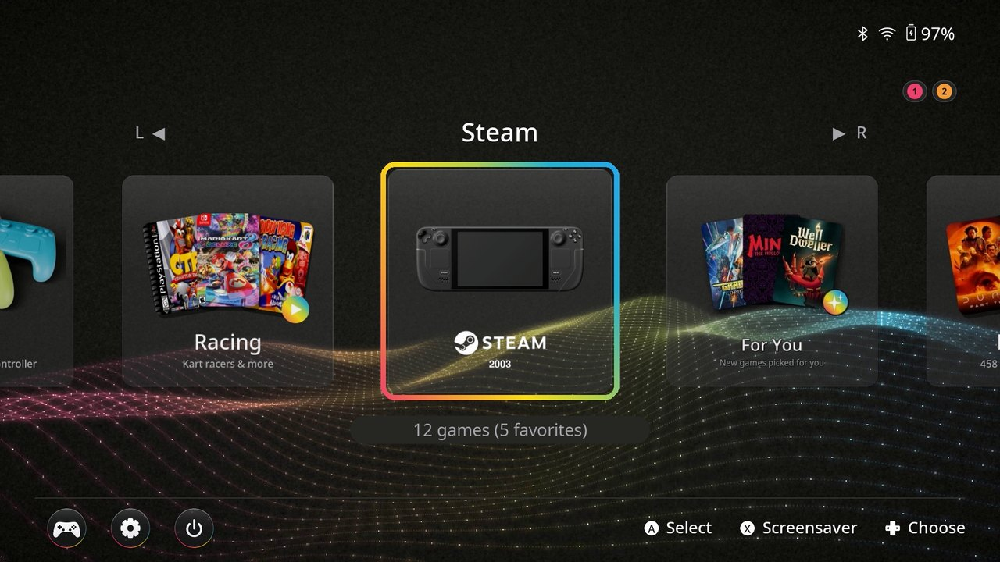
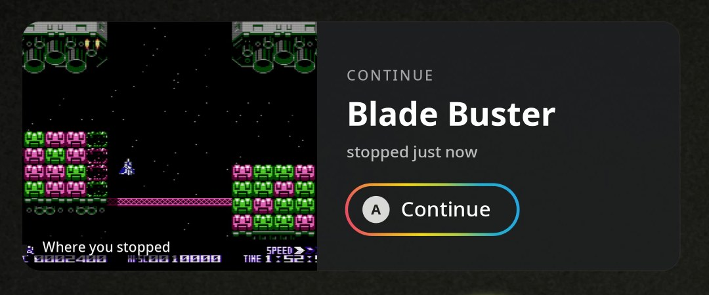
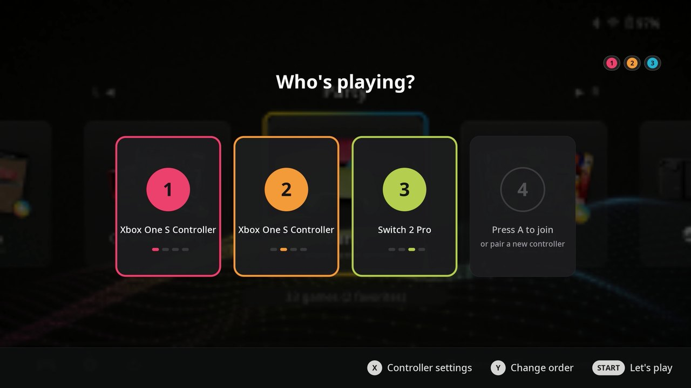
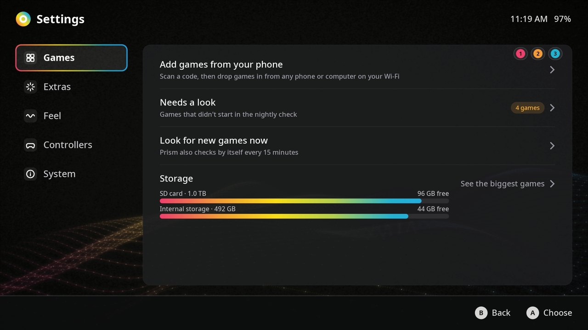

# Prism

Prism turns a Steam Deck into a living-room console. It boots straight into one home screen that holds your Steam
games, your emulated games and (optionally) your Plex movies and TV, and it behaves like a console: the Steam button
opens a quick-menu card over any game, controllers get player numbers in the order they're picked up, the screen
dims and sleeps on its own, and docking to a TV switches resolution and controls without asking.

**Case study and video:** [mitchellv.me/work/prism](https://www.mitchellv.me/work/prism) · by [Mitchell Vizensky](https://www.mitchellv.me), game UX designer

Prism is built on [ES-DE](https://es-de.org) (with a small patch), its own theme, and a set of background services
that run in Game Mode.



| Continue where you stopped | Who's playing? | Prism Settings |
|---|---|---|
|  |  |  |

> **Status: 1.0, early.** Prism runs daily on the Deck it was built on, installed by this installer, and the
> installer passes a full install / update / uninstall rehearsal. It hasn't been tried on other Decks yet, so try it
> on one you don't mind setting up again.

## Install

1. In Desktop Mode, download this repository (Code > Download ZIP) and unpack it anywhere, for example in Downloads.
2. Open the unpacked folder, then `install`, and double-click **Install Prism**.
3. Pick the extras you want. The installer asks once for the Deck's password (for the touchscreen and the Decky
   plugin); you can skip that step.
4. Return to Game Mode. Prism starts by itself.

Install from **Desktop Mode**: in Game Mode Steam restarts by itself while the installer adds the Prism shortcut.
Updates (running the installer of a newer download again) work from either mode and keep your settings; if an update
doesn't start properly, Prism goes back to the version before it by itself.

To remove it, double-click **Uninstall Prism** in `~/prism/install`. Your games, saves, EmuDeck, Steam library and your
normal ES-DE setup are never touched; Prism runs ES-DE with its own settings folder.

## What you get

**Core** (everyone):

- Boots into Prism; a rescue chord (hold L5 + R5) always gets you back to it
- Steam-button card over every game: resume, save and load states, quit, sleep timer
- Controllers / Settings / Power row on the home screen, with player numbers for each connected pad
- Screen dimming and screen-off when nobody is using the Deck, without stopping downloads
- Docked vs handheld profiles (resolution, controls, Wii pointer, Switch docked mode)
- New games show up on their own: install a Steam game, add a non-Steam shortcut or copy a ROM into
  `Emulation/roms/<system>/` and it appears in Prism within 15 minutes
- Party mode for local multiplayer: controller order follows who pressed a button first, in every emulator
- Glass UI sounds, startup and shutdown animations
- Safe gamelists: ES-DE saves them atomically and a daily backup keeps the last 14 days
- Continue: when you come back to the home screen, your last game is waiting with the frame where you stopped
- Never lose progress: the game is saved before the Deck sleeps, whenever it's closed, and at 5 % battery
- Only working games on the shelf: games that don't start in the nightly check move to a "Needs a look" row
- Prism fixes itself: broken game lists come back from the daily backup, stopped services restart, and you get a
  short note; a low-storage card comes well before the drive is full
- Who's playing?: player slots fill in as controllers press A; Y changes the order for every emulator
- Docking: the TV takes over with a short Prism moment; undock mid-game and the game waits behind a pause card
- Add games from your phone: scan a code in Settings and drop games in from any phone or computer on your Wi-Fi
- Trackpad haptics with the menu sounds (handheld)
- Prism Settings on the home screen: extras on and off, storage, controllers, Steam's settings
- Updates that undo themselves: if an update doesn't start, Prism goes back to the version that worked

**Optional** (chosen during install):

| Feature | What it adds | Needs |
|---|---|---|
| Movies & TV | Your Plex library as browsable rows, played full-screen with mpv, with Up Next and skip intro | A Plex server and its token; the `io.mpv.Mpv` Flatpak |
| Request Movies | Overseerr in a full-screen window from the Movies row | An Overseerr server; Google Chrome (Flatpak) |
| Nightly scrape | Box art and video for new games, fetched overnight with ES-DE's scraper | A free [ScreenScraper](https://www.screenscraper.fr) account |
| Xbox 360 | Xbox 360 games through Xenia Canary (Proton), dropped-in game folders converted automatically | EmuDeck's Xenia |
| Save backups | A nightly, versioned copy of every save to another machine over SSH | An SSH server with space for it |

Music (Plex music in a full-screen player) is in the repository but not part of the first release.

## Requirements

- Steam Deck (LCD or OLED) on SteamOS 3.7 or newer, used in Game Mode
- [EmuDeck](https://www.emudeck.com) set up, with its Emulation folder on the SD card or internal storage
- [Decky Loader](https://decky.xyz) (Prism's small Decky plugin talks to Steam's UI)
- The patched ES-DE 3.5.0 build (see [esde/README.md](esde/README.md))

Everything else Prism uses ships with SteamOS: Python 3 with `python-evdev`, GTK and cairo bindings, `xdotool`,
`ffmpeg`, `gamescopectl`, PipeWire tools.

## Settings

Prism finds its folders on its own: the Emulation folder comes from EmuDeck's settings, everything else from the
standard SteamOS locations. To change anything, create `~/.config/prism/config.toml`:

```toml
emulation = "/run/media/mmcblk0p1/Emulation"   # EmuDeck's Emulation folder, if Prism picks the wrong one
theme = "prism"                                 # ES-DE theme folder
overseerr_url = "http://192.0.2.10:5055"        # Request Movies
backup_ssh = "user@backup-host"                 # Save backups: where to send them
backup_dir = "/srv/backups/deck-saves"
```

`python3 prism_config.py` prints what Prism is using.

## What's in this repository

| Path | What it is |
|---|---|
| `*.py`, `*.sh` | The services and tools. `switchhome.py` is the supervisor that runs the input, screensaver, home, keyboard and media threads |
| `prism_config.py`, `prism_env.sh` | Where every path comes from (Python and shell) |
| `emu/` | Emulator wrappers: resume-where-you-left-off for Dolphin, DuckStation and PCSX2; the Xenia launcher |
| `selftest/` | The self-test that replays real play sessions with virtual input (`python3 selftest/run.py --force`) |
| `theme/prism/` | The ES-DE theme |
| `esde/` | The ES-DE patch, how to build it, ES-DE's event hooks, the custom systems file and the launcher |
| `decky/` | The Decky plugin Prism uses to talk to Steam's UI |
| `systemd/` | The user services and timers |
| `install/` | The installer and uninstaller (double-click in Desktop Mode), the one step that needs the Deck password, Steam shortcut art |
| `release/` | `export.py` builds this repository from a working Deck; `manifest.txt` lists which files belong to which feature |

Files under `systemd/` and `esde/` contain placeholders such as `@PRISM_DIR@`, `@ROMS@` and `@HOME@`; the installer
fills them in.

## Credits

See [CREDITS.md](CREDITS.md).

## License

Prism is under the [PolyForm Noncommercial License 1.0.0](LICENSE.md): anyone may use, change and share it for any
noncommercial purpose, but not sell it or use it commercially. Parts that come from other projects keep their own
licenses: the ES-DE patch and build are MIT-licensed ES-DE (`esde/LICENSE-es-de`), and the theme's system art and
metadata come from the MIT-licensed Linear theme (`theme/prism/LICENSE-linear`).
